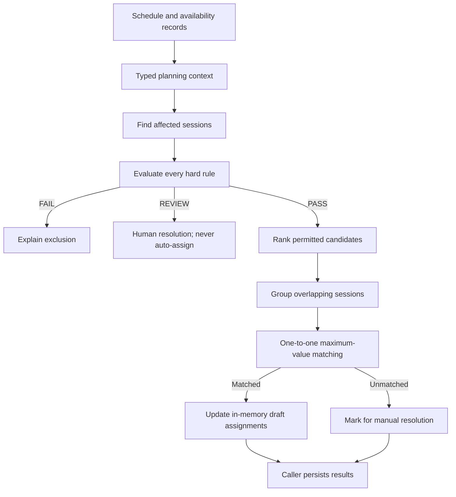

## The failure mode

Two overlapping jobs need coverage. Worker 10 is qualified for both; worker 20 can take only the first. A greedy pass gives worker 10 to the first job, then discovers that the second has nobody left. The schedule shows one uncovered job despite a valid assignment: give the first job to worker 20 and the second to worker 10.

This is not a tie-breaking problem. Changing which job is considered first changes which job is left uncovered; it does not make the decision globally sound. Sorting by urgency or by the first job’s highest-ranked worker still commits locally before accounting for the other jobs competing for that worker.

Here is the naive policy in executable form:

```python
def greedy(jobs: tuple[str, ...],
           eligible: dict[str, tuple[int, ...]]) -> dict[str, int | None]:
    used: set[int] = set()
    result: dict[str, int | None] = {}
    for job in jobs:
        worker = next((w for w in eligible[job] if w not in used), None)
        result[job] = worker
        if worker is not None:
            used.add(worker)
    return result

jobs = ("A", "B")
eligible = {"A": (10, 20), "B": (10,)}
picked = greedy(jobs, eligible)
assert picked == {"A": 10, "B": None}
```

The order in `eligible["A"]` encodes preference: worker 10 is the locally best choice. But the job-worker graph matters more than that local ranking. For job B, worker 10 is the only edge. Taking it away from B has a cost that a per-job greedy loop cannot see.

The fix is not to weaken qualifications or let a sufficiently high score excuse a conflict. First determine which edges are permitted. Then choose a set of non-conflicting edges across the whole overlap group.

## System architecture

The scheduler separates data loading from decision logic. A loader builds plain typed records; pure functions identify affected jobs and evaluate worker-job pairs. The matcher sees only candidates that passed every hard rule and do not require human review.



Availability, active status, existing overlaps, and job-specific qualifications determine whether an edge exists. Preference ranking happens only after that boundary. Missing mandatory data is represented as `REVIEW`: it can remain visible for a person to resolve, but it does not become an automatic assignment.

The matcher operates on one group of mutually overlapping sessions at a time. Non-overlapping sessions can reuse a worker, so combining them into one global assignment problem would impose a false constraint. The result is a mapping from assignment identifiers to a selected candidate or `None`; persistence stays with the caller, outside the pure matching routine.

## Core implementation

The guardrail is small: a candidate may be eligible for consideration while still requiring review, but automatic assignment accepts only verified candidates. The matcher cannot recover an edge that the hard-rule stage excluded.

```python
from dataclasses import dataclass
from typing import Literal

Outcome = Literal["PASS", "FAIL", "REVIEW"]

@dataclass(frozen=True)
class Candidate:
    worker_id: int
    outcomes: tuple[Outcome, ...]
    tier: int
    score: float

def eligible(candidate: Candidate) -> bool:
    return all(outcome != "FAIL" for outcome in candidate.outcomes)

def auto_assignable(candidate: Candidate) -> bool:
    return eligible(candidate) and all(
        outcome != "REVIEW" for outcome in candidate.outcomes
    )

def assignment_value(candidate: Candidate, coverage: float,
                     tier_bonus: dict[int, float], score_unit: float) -> float:
    return coverage + tier_bonus[candidate.tier] + candidate.score * score_unit

verified = Candidate(20, ("PASS", "PASS"), 2, 73.0)
unknown = Candidate(30, ("PASS", "REVIEW"), 1, 99.0)
assert auto_assignable(verified)
assert not auto_assignable(unknown)
```

In the real flow, all mandatory rules are evaluated for each pair so the result can explain every failure. Candidates with a `FAIL` are excluded; candidates with `REVIEW` remain distinguishable in ranked output but are filtered out before auto-fill. This matters because a large score, a strong preference, or a desirable tier must not transform missing evidence into permission.

For the remaining edges, the scheduler turns each candidate into a value with three levels: coverage first, priority tier second, score third. The coverage term is configured to dominate the other terms, so leaving a job unmatched cannot win merely because the remaining assignments score better. Tier and score then decide among alternatives that preserve coverage.

The assignment helper below minimizes cost by negating allowed values. A `None` cell is a forbidden pairing. It adds one private zero-value dummy column per job, allowing any row to remain unmatched without forcing an invalid worker assignment.

```python
def _max_value_assignment(values: list[list[float | None]]) -> list[int | None]:
    n = len(values)
    if n == 0: return []
    m, cols, big = len(values[0]), len(values[0]) + n, 1e12
    cost = [[(-x if x is not None else big) for x in row] +
            [0.0 if k == i else big for k in range(n)]
            for i, row in enumerate(values)]
    u, v = [0.0] * (n + 1), [0.0] * (cols + 1)
    p, way = [0] * (cols + 1), [0] * (cols + 1)
    for i in range(1, n + 1):
        p[0], j0 = i, 0
        minv, used = [float("inf")] * (cols + 1), [False] * (cols + 1)
        while True:
            used[j0] = True
            i0, delta, j1 = p[j0], float("inf"), 0
            for j in range(1, cols + 1):
                if not used[j]:
                    cur = cost[i0 - 1][j - 1] - u[i0] - v[j]
                    if cur < minv[j]: minv[j], way[j] = cur, j0
                    if minv[j] < delta: delta, j1 = minv[j], j
            for j in range(cols + 1):
                if used[j]: u[p[j]] += delta; v[j] -= delta
                else: minv[j] -= delta
            j0 = j1
            if p[j0] == 0: break
        while j0:
            j1 = way[j0]
            p[j0], j0 = p[j1], j1
    result: list[int | None] = [None] * n
    for j in range(1, cols + 1):
        if p[j] and j <= m and cost[p[j] - 1][j - 1] < big:
            result[p[j] - 1] = j - 1
    return result
```

For the synthetic example, the value matrix is `[[10, 9], [10, None]]`. The returned columns are `[1, 0]`: job A gets worker 20 and job B gets worker 10. The dummy columns mean the same routine also handles a group where no eligible worker exists for one or more jobs.

Determinism is part of the output contract, not an incidental property. Candidate workers are sorted by identifier before columns are built, jobs arrive in deterministic order, and the algorithm updates a predecessor only on a strictly lower cost. Identical inputs therefore produce the same matching, including when several assignments have equal value. That makes a draft explainable and repeatable without pretending the score is a probability.

## Benchmarks and trade-offs

The functional test demonstrates a narrow, exact comparison: the greedy choice covers 1 of 2 jobs; matching covers 2 of 2. That is 50% versus 100% coverage in this constructed case, not a measured success rate, production outcome, or performance benchmark. No latency or throughput benchmark has been run.

The implementation documents Hungarian-algorithm complexity as **O(n²m)**, where *n* is the number of sessions and *m* is the number of columns, including dummy unmatched columns. That is a theoretical bound, not a timing result. The explicit cost matrix uses **O(nm)** space. For small overlap groups, paying that modeling and implementation cost buys a useful global guarantee: among the allowed pairings, the selected combination maximizes total value.

The guarantee is deliberately bounded. Matching is per overlap group, not a multi-day workload optimizer. It does not account for travel, fairness across dates, or future schedule changes. The value coefficients also require care: coverage must dominate the possible sum of lower-level preferences, or the intended objective can silently change. A greedy strategy is simpler and may be sufficient when each job has an independent pool or when coverage is not the primary objective. Here, scarcity and overlapping eligibility make the global constraint worth modeling explicitly.

## Engineering judgment

Use one-to-one matching when decisions share scarce resources, hard eligibility is non-negotiable, and leaving eligible work uncovered has a clear cost. Keep qualification checks outside the objective, make uncertainty a visible non-automatic state, and make the objective’s ordering explicit in the value function. For independent choices, a stable ranked list is easier to explain and maintain. But once one choice can consume the only feasible option for another, local best-first assignment is not a simplification; it is an unspoken policy to accept avoidable uncovered work.