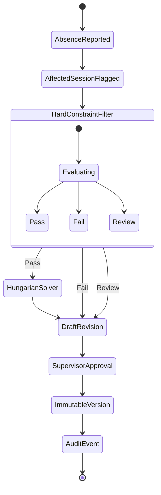

Scheduling software has an unusual failure mode compared to most backend systems: when it's wrong, it doesn't crash — it produces a schedule that looks completely plausible and is quietly incorrect. A clinician assigned to a session they're not qualified for, or a published schedule silently overwritten after a supervisor already approved it, doesn't throw an exception. It just happens, and someone finds out when it's too late to fix cleanly.

This post covers the design of a scheduling engine built around a simple premise: optimization should be the *last* step, not the first, and anything the system isn't certain about should stop and ask a human rather than guess. The examples here use a synthetic clinical-scheduling scenario — no real patient, staff, or organizational data.

## Why silent auto-overwrite breaks trust

The tempting naive design is: staff member reports an absence, system immediately recomputes an optimal schedule, publishes it. This fails in practice for one specific reason — a published schedule is a commitment other systems and people have already built on. Patients have been told their appointment time. A supervisor approved the version currently live. If the system silently regenerates and republishes without surfacing *what changed and why*, it erodes the one thing that makes an automated scheduler usable at all: operators trusting that what they see is what's actually happening.

The same applies to missing data. If a staff member's certification record is incomplete, the wrong failure mode is to assume they're ineligible (they might lose shifts they're actually qualified for) or assume they're eligible (a compliance risk). The correct behavior is a third state: `REVIEW` — surface it to a human, don't guess either direction.

## State machine



Every absence report triggers a flag on the sessions it affects, which then runs through a hard-constraint filter before anything resembling optimization happens. The solver only ever sees candidates that already passed deterministic eligibility — it never has the authority to override a hard rule for the sake of a better-optimized schedule.

## Deterministic PASS / FAIL / REVIEW eligibility rules

Eligibility is evaluated by an explicit, ordered set of checks — not a single boolean, because the *reason* a candidate fails matters for the audit trail and for the supervisor reviewing the draft.

```python
from dataclasses import dataclass
from enum import Enum, auto


class Eligibility(Enum):
    PASS = auto()
    FAIL = auto()
    REVIEW = auto()


@dataclass
class EligibilityResult:
    status: Eligibility
    reason: str


def evaluate_eligibility(staff_member, session) -> EligibilityResult:
    """Ordered, deterministic eligibility checks.

    Order matters: a REVIEW case (missing data) is checked before any FAIL
    that would otherwise require data we don't actually have yet.
    """
    if staff_member.certification_on_file is None:
        return EligibilityResult(
            Eligibility.REVIEW,
            "certification record missing — cannot confirm eligibility",
        )

    if session.required_certification not in staff_member.certifications:
        return EligibilityResult(
            Eligibility.FAIL,
            f"missing required certification: {session.required_certification}",
        )

    if staff_member.has_conflicting_session(session.time_window):
        return EligibilityResult(
            Eligibility.FAIL, "time conflict with an existing assignment"
        )

    if staff_member.hours_this_week + session.duration_hours > staff_member.max_weekly_hours:
        return EligibilityResult(
            Eligibility.REVIEW,
            "assignment would exceed weekly hour cap — needs override approval",
        )

    return EligibilityResult(Eligibility.PASS, "eligible")


def filter_candidates(staff_pool, session) -> tuple[list, list[EligibilityResult]]:
    """Returns (eligible_staff, all_results) — all_results feeds the audit log
    even for candidates who didn't pass, so a supervisor can see why."""
    eligible = []
    results = []

    for staff_member in staff_pool:
        result = evaluate_eligibility(staff_member, session)
        results.append(result)
        if result.status is Eligibility.PASS:
            eligible.append(staff_member)

    return eligible, results
```

Only candidates with `PASS` ever reach the optimizer. `REVIEW` results stop the pipeline for that session and surface in the draft revision as an explicit flag rather than being silently dropped or silently included.

## Cost-matrix formulation for optimal assignment

Once we have a pool of eligible candidates for each affected session, assignment becomes a classic bipartite matching problem: minimize total cost (or equivalently, maximize preference/fit) across staff-to-session pairings, subject to each staff member and each session being used at most once. `scipy.optimize.linear_sum_assignment` implements the Hungarian algorithm, solving this optimally in $O(N^3)$ time for an $N \times N$ cost matrix.

```python
import numpy as np
from scipy.optimize import linear_sum_assignment


def build_cost_matrix(eligible_staff, open_sessions) -> np.ndarray:
    """Lower cost = better fit. We penalize (not forbid — ineligibility
    already happened upstream) overtime proximity and preference mismatch."""
    n_staff = len(eligible_staff)
    n_sessions = len(open_sessions)
    size = max(n_staff, n_sessions)

    # Pad with a high-cost dummy so scipy's square-matrix requirement
    # doesn't force a real assignment where none should exist.
    DUMMY_COST = 1_000.0
    cost_matrix = np.full((size, size), DUMMY_COST)

    for i, staff_member in enumerate(eligible_staff):
        for j, session in enumerate(open_sessions):
            overtime_penalty = max(
                0, staff_member.hours_this_week + session.duration_hours
                - staff_member.preferred_weekly_hours
            )
            preference_penalty = 0 if session.id in staff_member.preferred_sessions else 2
            cost_matrix[i, j] = overtime_penalty + preference_penalty

    return cost_matrix


def solve_assignment(eligible_staff, open_sessions):
    cost_matrix = build_cost_matrix(eligible_staff, open_sessions)
    row_idx, col_idx = linear_sum_assignment(cost_matrix)

    assignments = []
    for r, c in zip(row_idx, col_idx):
        if r < len(eligible_staff) and c < len(open_sessions):
            assignments.append((eligible_staff[r], open_sessions[c]))

    return assignments
```

The dummy-cost padding matters: `linear_sum_assignment` requires a square cost matrix, but we almost never have exactly as many eligible staff as open sessions. Padding with a high but finite cost (rather than infinity, which can produce numerical issues) lets the solver still find the best *possible* real assignment without being forced to fill every slot with a bad match.

## Immutable versions and append-only audit logs

The draft produced by the solver never overwrites the published schedule directly. It becomes a new version, requires supervisor approval, and only then is committed — and even then, nothing is ever updated in place.

```python
from sqlalchemy import select
from sqlalchemy.exc import StaleDataError


class ScheduleVersion(Base):
    __tablename__ = "schedule_versions"

    id = Column(Integer, primary_key=True)
    schedule_id = Column(Integer, ForeignKey("schedules.id"), nullable=False)
    version_number = Column(Integer, nullable=False)
    content = Column(JSON, nullable=False)
    approved_by = Column(Integer, ForeignKey("users.id"), nullable=True)
    approved_at = Column(DateTime, nullable=True)
    # optimistic concurrency token
    version = Column(Integer, nullable=False, default=1)

    __mapper_args__ = {"version_id_col": version}


class AuditEvent(Base):
    __tablename__ = "audit_events"
    __table_args__ = (
        # Append-only: no UPDATE or DELETE grants on this table at the DB
        # role level, enforced outside the ORM as well as within it.
    )

    id = Column(Integer, primary_key=True)
    schedule_version_id = Column(Integer, ForeignKey("schedule_versions.id"))
    event_type = Column(String, nullable=False)  # e.g. "draft_created", "approved"
    actor_id = Column(Integer, ForeignKey("users.id"), nullable=False)
    payload = Column(JSON, nullable=False)
    created_at = Column(DateTime, nullable=False, server_default=func.now())


def approve_schedule_version(session, version_id: int, supervisor_id: int):
    version = session.get(ScheduleVersion, version_id)

    try:
        version.approved_by = supervisor_id
        version.approved_at = datetime.utcnow()
        session.flush()  # triggers SQLAlchemy's version_id_col check
    except StaleDataError:
        # Someone else modified this version concurrently — refuse the
        # approval rather than silently clobbering their change.
        session.rollback()
        raise ConcurrentModificationError(
            f"Schedule version {version_id} was modified by another "
            "process. Re-fetch and retry."
        )

    session.add(AuditEvent(
        schedule_version_id=version.id,
        event_type="approved",
        actor_id=supervisor_id,
        payload={"version_number": version.version_number},
    ))
    session.commit()
```

Two things are doing the real work here:

1. **Optimistic concurrency** via SQLAlchemy's `version_id_col` means two supervisors can't both approve conflicting changes to the same draft without one of them getting a clear `ConcurrentModificationError` instead of a silently lost update.
2. **Append-only audit events** mean the audit table has no legitimate `UPDATE` or `DELETE` path — enforced both at the ORM layer (no update methods exposed for `AuditEvent`) and at the database role level (the application's DB user has `INSERT`/`SELECT` grants only on that table). Every state transition — flag raised, candidate filtered with its reason, draft created, approved — is a new row, never a mutation, so reconstructing "what did the schedule look like on Tuesday, and who approved what" is always a query, never a guess.

## Why this is worth the extra complexity

A simpler design — recompute and republish immediately, update rows in place, skip the `REVIEW` state — would be meaningfully less code. It would also be the kind of system where, the first time it does something an operator doesn't expect, nobody trusts its output again. For scheduling software specifically, the cost of an operator manually double-checking every automated change is high enough that it defeats the purpose of automating in the first place. The hard-constraint filter, the explicit `REVIEW` state, and the immutable audit trail exist specifically so that trust, once established, doesn't have a reason to erode.
